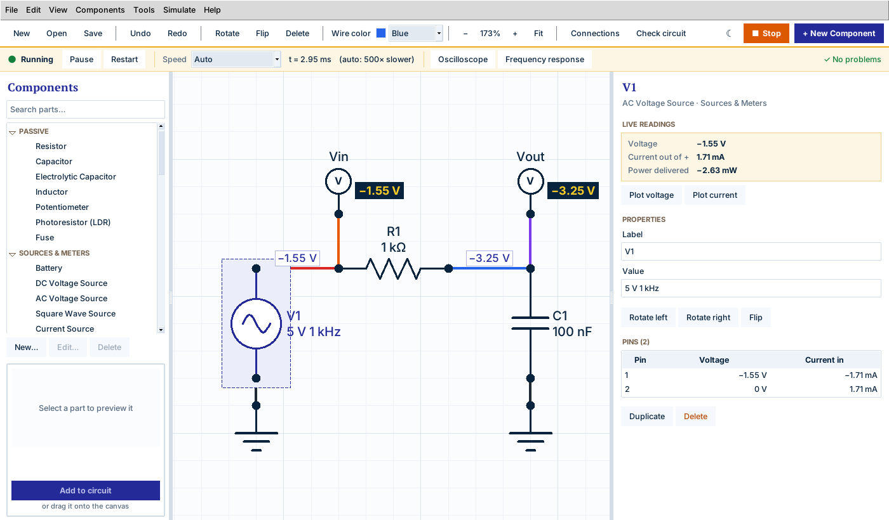

# Circuit Builder

A simple circuit and wiring editor for Windows, made for undergraduate labs.
Drag parts onto a grid, click pin-to-pin to wire them, create your own parts with any pins you need, and **simulate the circuit** to see voltages, currents, glowing LEDs and waveforms.



## Getting it running

**Option A: run it with Python (quickest)**

1. Install Python 3.8 or newer from <https://www.python.org/downloads/windows/>.
   In the installer, tick **"Add python.exe to PATH"**.
2. Double-click **`Run Circuit Builder.bat`**.

Nothing else needs installing; the app only uses Python's built-in Tkinter.
Optional: `pip install pillow` makes part pictures a little smoother and lets the app open WebP pictures too.

**Option B: make a stand-alone `.exe` (to share with a class)**

1. On any PC with Python installed, double-click **`Build Windows EXE.bat`**.
   It installs PyInstaller once and builds the app (takes about a minute).
2. Your app appears as **`dist\CircuitBuilder.exe`**. That single file runs on any Windows 10/11 PC without Python. Copy it to a USB stick or a shared drive.

Because the `.exe` is not code-signed, Windows SmartScreen may show "Windows protected your PC" the first time.
Click **More info → Run anyway**.

## How to use it

| To… | Do this |
|---|---|
| Add a part | Drag it from the **Components** list onto the grid, or double-click it and then click where it should go |
| Connect two pins | Click a pin (small circle), then click a pin on another part. You can also drag from pin to pin |
| Add corners to a wire | While wiring, click empty grid squares on the way. Backspace removes the last corner |
| Reshape a wire later | Double-click the wire to add a bend, then drag the white square |
| Edit label / value | Click the part and type in the panel on the right (e.g. `R1`, `4.7 kΩ`) |
| Give a part a picture | Click the part, then **Add picture…** in the panel on the right (see below) |
| Rotate / flip | **R** (Shift+R rotates the other way), **F** to flip |
| Delete | Select and press **Delete** (deleting a part also deletes its wires) |
| Copy, paste, duplicate | **Ctrl+C**, **Ctrl+V**, **Ctrl+D** |
| Undo / redo | **Ctrl+Z** / **Ctrl+Y** |
| Zoom / move around | Mouse wheel zooms; right- or middle-drag pans; **0** fits the circuit |
| Select several things | Drag a box around them, or Ctrl+click |
| Simulate | **▶ Simulate** (top right) or **F5**; press again to stop |
| Light / dark mode | Click **☾** (next to Simulate; it turns into **☀** to switch back) or tick *View › Dark mode* |

Pins show **filled** when connected and **hollow** while still free.
Hover over a pin to see its name and which net it is on.

**Dark mode** recolors every window straight away, including the Component Editor, oscilloscope and Bode plot if they are open, and the app remembers your choice next time.
Wires and traces are drawn a little brighter in dark mode so they stand out (a *Black* wire shows as light grey), but your files keep the colors you picked, and *Export image (SVG)* always uses the normal light colors so drawings print well in lab reports.
On Windows 10/11 the title bars turn dark too; the menu bar strip itself follows Windows' own colors.

**Ground and power rails:** every Ground symbol is connected together, and so is every Power Rail (VCC) with the same value (e.g. `+5 V`).
You can put a ground symbol wherever it's convenient instead of running long wires.

## Flip-flops and latches

The **Flip-Flops & Latches** group in the parts list has four parts for digital logic labs (5 V logic, like the logic gates):

| Part | Pins | What it does |
|---|---|---|
| **D Flip-Flop** | D, CLK, Q, Q', SET, CLR | On each rising edge of CLK (LOW → HIGH), Q copies D and holds it until the next edge |
| **T Flip-Flop** | T, CLK, Q, Q', SET, CLR | On each rising edge, Q flips if T is HIGH and stays the same if T is LOW |
| **JK Flip-Flop** | J, K, CLK, Q, Q', SET, CLR | On each rising edge: J = K = 0 holds, J = 1 sets, K = 1 resets, J = K = 1 toggles |
| **SR Latch** | S, R, Q, Q' | No clock: S = 1 sets Q, R = 1 resets Q, both 0 remembers |

- **Q'** ("Q-bar", drawn as Q with a bar over it) is always the opposite of Q.
- The clock input is the one marked with a small triangle.
- **SET** and **CLR** are optional: while one of them is HIGH it forces Q to 1 or 0, whatever the clock is doing. Leave them unconnected if you don't need them; Check circuit doesn't complain about unused SET, CLR or Q' pins.
- When simulating, each flip-flop shows **Q = 0** or **Q = 1** under it. Click it for its inputs, outputs and how many clock edges it has seen.
- An unconnected logic input counts as LOW, and so does an input driven by a switch that is open, so a push button from +5 V to CLK works as a clock button.
- Not allowed: SET and CLR both HIGH (Q and Q' both go to 1), or S and R both HIGH on the latch (both go to 0). The simulator warns you.

Try *File › Open example › 2-bit counter with flip-flops*: a 1 Hz clock drives two T flip-flops, and their LEDs count 0, 1, 2, 3 in binary.
To build a toggle button yourself, wire a D flip-flop's Q' back to its D and clock it with a push button: every press flips Q.

## Logic chips and your own chip logic

**74HC chips.** The **Logic ICs (74HC)** group has real 14-pin chips drawn in their actual pin order (pin 1 top-left, GND = pin 7 bottom-left, VCC = pin 14 top-right), so the drawing matches the chip on a breadboard:
74HC00 (quad NAND), 74HC02 (quad NOR), 74HC04 (hex inverter), 74HC08 (quad AND), 74HC32 (quad OR), 74HC86 (quad XOR) and 74HC74 (dual D flip-flop, with active-LOW PRE and CLR: connect them to VCC for normal use).
Just like the real thing, a chip only works once **VCC is wired to +5 V and GND to ground**: the simulator warns you if you forget, and the current your LEDs draw really flows in through the VCC pin.

**Give your own parts logic.** Any part you make can work as a digital chip in the simulator. In the Component Editor, under *Logic (for the simulator)*, click **Add logic…** and describe what the chip does, one line per output:

```
# half adder
SUM   = A ^ B
CARRY = A & B
```

| Write | Meaning |
|---|---|
| `Y = A & B` | Y follows its inputs straight away (combinational logic) |
| `Q = D on CLK` | Q takes the value of D on each rising edge of CLK (`on fall CLK` for falling edges) |
| `Q = 0 when RST` | while RST is 1, Q is forced to 0 (beats the clock: use it for resets and presets) |
| `Q = D when EN` | a latch: Q follows D while EN is 1 and remembers when EN goes to 0 |
| `A & B`, `A * B`, `A and B` | AND |
| `A \| B`, `A + B`, `A or B` | OR |
| `A ^ B`, `A xor B` | XOR |
| `!A`, `~A`, `A'`, `not A` | NOT |

- **Names** are the part's pin names, written exactly (capitals matter). A pin name with spaces or symbols can go in quotes, e.g. `"D0 RX"`. Any other name on the left of `=` is an internal signal, handy for counters and state machines.
- **Inputs and outputs** are worked out for you: pins you set are outputs, pins you only read are inputs.
- **Power:** if the part has pins called VCC and GND (or 5V, VDD, VSS …), the outputs swing between them and the chip needs power to work. A part without power pins runs as 5 V logic, like the logic gates.
- The editor checks every line as you type, marks the line with a problem in red with a plain-English explanation, and shows the **truth table** (for clocked parts it shows each stored bit "now" and "after CLK↑").
- **Start from an example ▾** gives ready-made logic: quad NAND, half and full adder, multiplexer, 2-to-4 decoder, majority vote, D latch, D flip-flop with reset, 4-bit counter, 4-bit shift register and a traffic-light sequencer. It can add the pins the example needs.
- While simulating, every logic pin of the chip shows a **green dot when HIGH** and a **grey dot when LOW**, and clicking the chip lists its inputs and outputs.
- To start from a built-in chip (for example to make a 74HC10 from the 74HC00), select it in the parts list, click **Edit…**, and change its pins and logic.
- An unconnected logic input counts as LOW. On a real CMOS chip you should connect unused inputs to GND or VCC.

## Simulating a circuit

Press **▶ Simulate** (or **F5**). A green bar appears under the toolbar and the circuit starts running:

- **Voltages appear on the wires** (each net, measured from Ground). Turn them off under *Simulate › Show voltages on wires*.
- **LEDs and lamps glow** in proportion to their current, motors spin, buzzers show a ♪, blown fuses get a red ✕.
- **Voltmeters, ammeters and voltage probes** show a reading next to them, and flip-flops show their stored bit.
- **Hover over any part** for its voltage, current and power. **Click a part** to see full live readings in the right-hand panel, including the voltage and current at every pin (a transistor also shows whether it is off, amplifying or saturated).
- **Interact:** click a switch to flip it, hold the mouse down on a push button to press it. Potentiometers (wiper position), LDRs (light level) and the TMP36 sensor (temperature) get a slider in the right-hand panel.
- **Keep editing:** add parts, rewire, change values or undo while it runs; the simulation updates straight away (flip-flops keep what they have stored).
- **Messages:** click an empty spot on the canvas (or the message at the right of the green bar) to see warnings, e.g. an LED with no series resistor ("a real LED would burn out"), a ¼-watt resistor that would overheat, a reversed electrolytic capacitor, a 7805 without enough input voltage, or a short circuit. Click a message to select that part.

The green bar also has **Pause**, **Restart** (back to time zero: capacitors empty, fuses replaced, flip-flops cleared) and a **Speed** setting.
*Auto* picks a speed that suits the circuit: a 1 kHz filter runs about 500× slower than real time so you can watch the waves, while a 555 blinker at 1 Hz runs in real time.

**Oscilloscope.** Right-click a wire (*Plot this voltage*) or a part (*Plot voltage across* / *Plot current through*) to add it to the oscilloscope, or use the **Oscilloscope** button. Voltage probes and meters are added automatically. Choose how much time is shown, pause, clear, and **Export CSV** to analyse the data in Excel.

**Frequency response (Bode plot).** *Simulate › Frequency response* (or the button in the green bar) feeds a small sine wave into the chosen source and plots gain (dB) and phase at the chosen measuring point from, say, 10 Hz to 1 MHz. It reports the −3 dB cutoff of low-pass, high-pass and band-pass circuits, and you can hover the plot to read exact values or export it as CSV.

**What is simulated:** resistors, potentiometers, LDRs, fuses, capacitors (including electrolytic), inductors, batteries (with a small internal resistance), DC / AC / square-wave sources, current sources, power rails, voltmeters, ammeters, voltage probes, switches, push buttons, lamps, motors, buzzers, diodes, Zener diodes, LEDs, NPN / PNP transistors, N-MOSFETs, op-amps, logic gates and flip-flops (5 V logic), the 74HC logic chips, the 555 timer, the 7805 regulator, the TMP36 sensor, the relay module, and any part you give logic equations.
Microcontroller boards (Arduino, Pico), digital modules (LCD, ultrasonic sensor, servo), generic ICs and parts you make yourself without logic are **not** simulated (their pins are left unconnected). A copy of a simulated part, for example a 555 you gave a picture, still simulates as long as its pin names stay the same.

**Values the simulator reads** from each part's *Value* box:

| Part | Examples |
|---|---|
| Resistor, potentiometer | `470 Ω`, `4.7k`, `1 MΩ` |
| Capacitor, inductor | `100 nF`, `10 µF` (or `10 uF`), `1 mH` |
| Battery, DC source, power rail | `9 V`, `+5 V`, `-12 V` |
| AC source | `10 V 60 Hz` (peak), `120 V rms 60 Hz`, `20 Vpp 1 kHz` |
| Square-wave source | `5 V 1 Hz` (0 V to 5 V, 50 % duty) |
| Current source, fuse | `1 mA`, `500 mA` |
| Lamp, motor | `6 V 1 W`, `6 V 0.2 A` (rated values) |
| LED | `Red`, `Green`, `Blue`, `Yellow`, `White` … (sets the forward voltage and glow color) |
| Zener diode | `5.1 V` |
| Diode | `1N4148` (default), `1N4001`, `1N5817` / `Schottky` |
| Transistor | `hFE=200` sets the current gain (default about 150) |
| N-MOSFET | `2N7000` (default), `IRF540`, `IRLZ44` |
| Op-amp | `LM741` (default), `LM358` (output reaches V−), `rail-to-rail` |

The models are simplified for learning (like SPICE, but with typical values): an op-amp has a gain of 200 000 and its output stops about 1.5 V short of its supply rails (±15 V is assumed if V+/V− aren't wired); logic gates and flip-flops switch at 2.5 V and output 0 V or 5 V, and flip-flops change on the rising edge of CLK; the relay module switches COM to NO when IN is HIGH.
Expect small differences from a lab measurement, just as with any simulator.

*File › Open example* has four circuits made for simulating: an **RC low-pass filter** (try the oscilloscope and the Bode plot), a **transistor switch** (hold the push button), a **555 LED blinker** and a **2-bit counter with flip-flops**.

## Making your own components

Click **+ New Component** (top right), then:

1. **Details**: name, category, label prefix (`U` → U1, U2 …), optional default value, body color and picture.
2. **Pins**: type a pin name, pick the side it sticks out of (left, right, top or bottom) and press Enter.
   Type several names at once separated by commas, e.g. `VCC, GND, SDA, SCL`.
   Use **Move up/down** to reorder and **Add gap** to leave space between groups of pins.
   For chips, **Quick start: chip (DIP) with N pins** creates numbered pins 1…N in the standard order.
   For an Arduino-style board, tick **This is a microcontroller or dev board** so Check circuit ignores its unused pins.
3. **Preview** updates as you go. Click **Save to library**.

Your parts appear under their category (marked ★) and are remembered for next time.
To start from an existing part (e.g. turn the Arduino Uno into a Mega), select it and click **Edit…**; built-in parts open as a copy.
If you change a part that's already in your circuit, the wires stay attached to pins with the same name.

## Pictures on parts

Any box-shaped part (your own parts, and built-in boards and modules like the Arduino Uno, servo or relay) can show a picture, such as a photo of the real module.
The picture sits in the middle of the part with the label underneath, and the pins stay where they are.

- **On the canvas:** click the part, then click **Add picture…** (or **Change picture…**) in the panel on the right and choose the file.
  The Component Editor opens with a preview; click **Save to library**.
  For a built-in part this saves your own copy (★) with the picture, and the part you clicked switches to it with its wires kept.
- **In the Component Editor:** use **Picture › Choose…** or click the empty picture box. **Remove** takes it off again.
- **In the parts list:** right-click a part and choose **Add picture…** (built-in parts: **Copy with a picture…**).

PNG, JPG, GIF and BMP pictures all work on Windows. Large photos are shrunk to 400 pixels when you add them, so files stay small.
With **Size → Automatic** ticked, the part grows to make room for the picture; untick it to set the size yourself.
Click the picture in the right-hand panel to see it bigger.
Schematic symbols (resistor, LED, logic gates, flip-flops …) keep their standard drawing. To make a picture version, select one in the list, click **Edit…** to make your own copy, and add the picture there.

Pictures are saved inside the part, so they travel with `.cblib` and `.circuit` files and appear in **Export image (SVG)**.

**Sharing parts:** *Components › Export my components* saves a `.cblib` file. Classmates load it with *Components › Import components*.
Circuit files also carry the custom parts they use, so opening someone's `.circuit` file adds their parts to your library automatically.
`examples\Sample components.cblib` has three ready-made modules to try.

## Checking your work

- **Connections** (toolbar) lists every *net*, a group of pins wired together that share the same voltage.
  Click a net to highlight it on the drawing. Export it as text, CSV (Excel), or a basic **SPICE** netlist for R, C, L, sources, diodes, LEDs, Zeners and BJTs.
- **Check circuit** warns about shorted batteries and sources, parts that are shorted or not connected, free pins, and a missing ground.
  Double-click a message to jump to that part.
- **Microcontrollers:** a board like an Arduino uses only a few of its pins, so Check circuit doesn't list unused pins on parts marked as a microcontroller.
  Instead it warns if none of the board's GND pins is wired, and notes if no power pin (5V, VIN, 3V3 …) is wired (fine when the board runs on USB).
  The built-in Arduino Uno is already marked. For your own boards, tick **This is a microcontroller or dev board** under **Pins** in the Component Editor.
  To change it for one part in a circuit, click the part and use the **Microcontroller / dev board** checkbox in the right-hand panel (saved in the `.circuit` file).
- **Simulate** (see above) shows what the circuit actually does and flags parts that would be damaged.
- **File › Export image (SVG)** saves a clean drawing for lab reports, pictures included. It opens in any browser, Word or PowerPoint.

## Built-in parts

Resistor, capacitor, electrolytic capacitor, inductor, potentiometer, LDR, fuse, battery, DC/AC voltage source, square-wave source, current source, power rail, ground, voltmeter, ammeter, voltage probe, switch, push button, lamp, DC motor, buzzer, diode, Zener diode, LED, NPN/PNP transistors, N-MOSFET, op-amp, AND/NAND/OR/NOR/XOR/NOT gates, D/T/JK flip-flops, SR latch, 74HC00/02/04/08/32/86/74 logic chips, Arduino Uno, Raspberry Pi Pico, 555 timer, 7805 regulator, generic 8- and 14-pin ICs, servo, ultrasonic sensor, TMP36, I2C LCD and relay module.

*File › Open example* has seven ready-made circuits (the first three are also in the `examples` folder).

## Files and storage

- Circuits are saved as `.circuit` files (plain JSON, easy to grade or diff). Switch positions and slider settings are saved with the circuit.
- Your component library and settings (including light or dark mode) live in `%APPDATA%\CircuitBuilder\`.
  Copy `my_components.cblib` from there to back them up.
- To open a `.circuit` file by double-clicking, right-click it → *Open with* → choose `CircuitBuilder.exe`.

## For instructors: adding built-in parts

Every built-in part is one entry in the `BUILTIN_DEFS` list near the top of `circuit_builder.py`.
A chip or module is a single `BX(...)` line: id, name, category, label prefix, default value, description, width, height, and pins as `(name, side, position)`:

```python
BX("dht22", "DHT22 Sensor", "Modules & Sensors", "U", "", "Temperature & humidity sensor.",
   5, 4, [("VCC", "left", 1), ("DATA", "left", 2), ("GND", "left", 3)], color="#fef3c7"),
```

A digital chip can simulate from logic equations: add `logic="..."` to its `BX(...)` line (see the 74HC parts, which use the `DIP14(...)` helper to lay out a 14-pin chip in its real pin order).

An optional `optional_pins=[...]` list names pins that Check circuit shouldn't report when they're left unconnected (the flip-flops use it for SET, CLR and Q').

To make a new part simulate, add a branch for its id in `_make_device()` (search for it in `circuit_builder.py`) using one of the existing models, for example `Resistor`, `VSource`, `Diode` or `FlipFlop`, and add the id to `SIM_MODELS`.
The simulator itself (modified nodal analysis with Newton-Raphson, BDF2 time steps and an AC sweep) is in the *Simulation engine* section and uses only the Python standard library.

Rebuild the `.exe` afterwards if you hand that out.

## Troubleshooting

- **Nothing happens when I double-click the .bat**: Python isn't on the PATH. Reinstall Python and tick "Add python.exe to PATH".
- **The exe build fails with `PermissionError: [WinError 5] Access is denied`**: OneDrive (or Dropbox) locked PyInstaller's files. `Build Windows EXE.bat` now builds in your TEMP folder to avoid this; if you still see it, delete any old `build` folder next to the script (pause OneDrive syncing first) and run it again.
- **Everything looks tiny or huge**: use the zoom buttons or **Fit**. The app follows your Windows display scaling.
- **I lost a custom part**: check `%APPDATA%\CircuitBuilder\my_components.cblib`, or re-import a `.cblib` / open a `.circuit` that used it.
- **The simulation says "Short circuit"**: a battery, source or power rail has a plain wire (or an ammeter) straight across it. Click the message to find the part.
- **A part shows "not simulated"**: it has no simulation model (see *What is simulated* above); its pins are left unconnected.
- **"Running (slower than the chosen speed)"**: the circuit is too big to simulate at that speed on this PC. Pick a slower speed or *Auto*.
- **A logic chip's outputs stay LOW**: wire its VCC pin to +5 V and its GND pin to ground. On a 74HC74, also connect PRE and CLR to VCC (they are active-LOW, so leaving them LOW holds the flip-flop in preset/clear).
- **"Line 3: there is no pin or signal called …"** in the logic editor: the name doesn't match a pin exactly (capitals matter), or two names are written next to each other without an operator (write `A & B`, not `AB`).
- **A flip-flop never changes**: check that CLK is wired and actually goes from LOW to HIGH. Q only changes on that rising edge, not while the clock stays HIGH.
